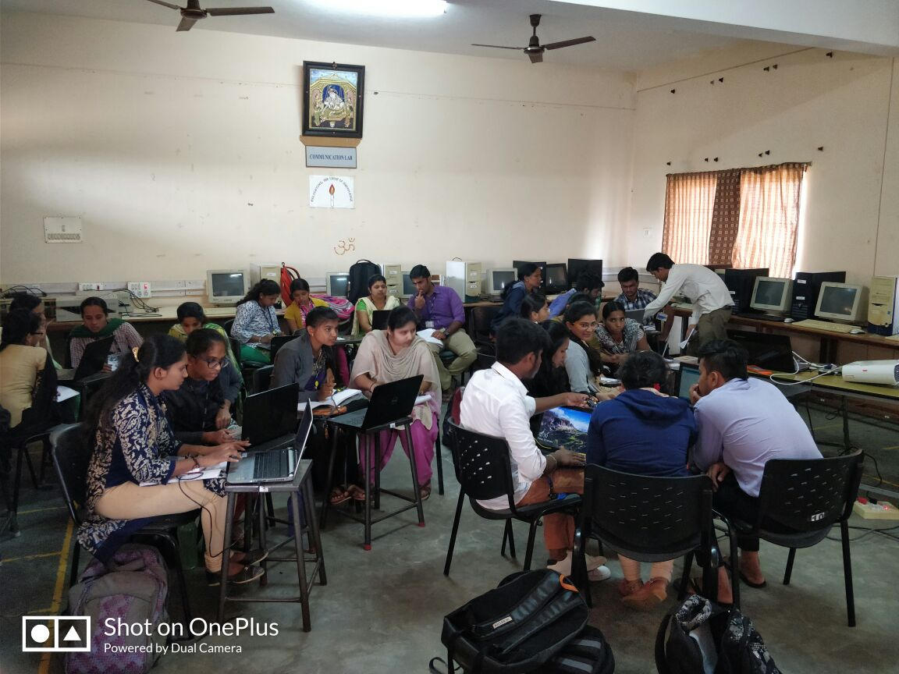
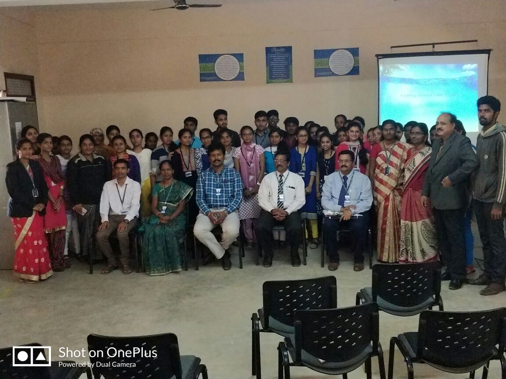
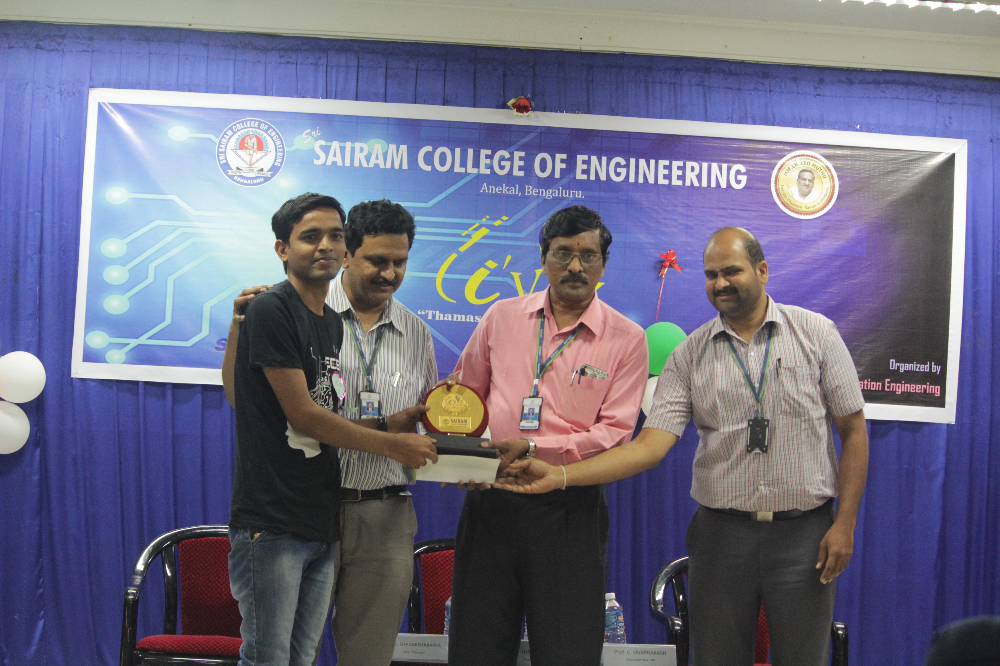

---
{
  "title": "Introducing juniors to Arduino: a college workshop",
  "summary": "I led a practical Arduino workshop for junior students at Sri Sairam College of Engineering, demonstrating the Arduino IDE and hands-on interfacing with Arduino Uno boards.",
  "category": "community",
  "status": "Workshop leader",
  "date": "2018-01-24",
  "draft": false,
  "image": "/assets/images/arduino-workshop-concepts.jpg",
  "image_alt": "Explaining Arduino workshop concepts to students during a lab session"
}
---

## The workshop

From January 24 to 28, 2018, I led an embedded systems workshop for junior students at Sri Sairam College of Engineering. I served as the resource person, with support from other students.

## What I covered

I demonstrated the Arduino IDE and guided hands-on interfacing exercises using Arduino Uno boards. The session introduced students to working with the board and its development environment.

## Workshop memories

