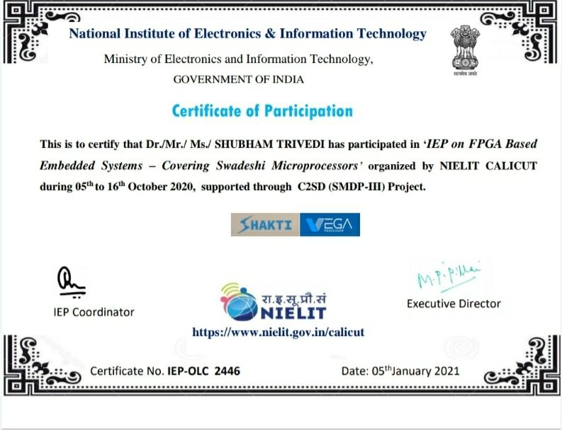

---
{
  "title": "Exploring FPGA-based embedded systems",
  "summary": "NIELIT Calicut participation evidence for a program covering Swadeshi microprocessors.",
  "category": "training",
  "status": "Participated",
  "image": "/assets/images/nielit.jpg",
  "image_alt": "NIELIT Calicut certificate for FPGA-based embedded systems participation"
}
---

## Continued learning

I participated in NIELIT Calicut's program on FPGA-based embedded systems covering Swadeshi microprocessors, held October 5–16, 2020. The certificate was issued in January 2021 and includes SHAKTI and VEGA.

[Original LinkedIn post](https://www.linkedin.com/feed/update/urn:li:activity:6752854756118671360/)

This records participation; it does not claim that I designed either processor.
