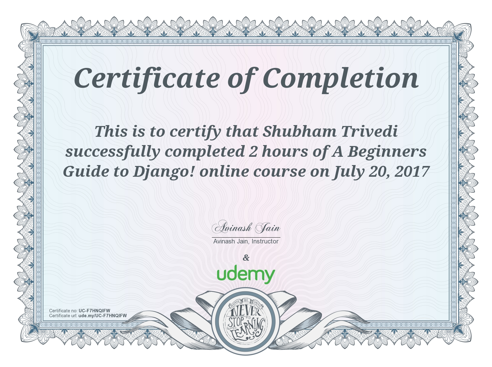
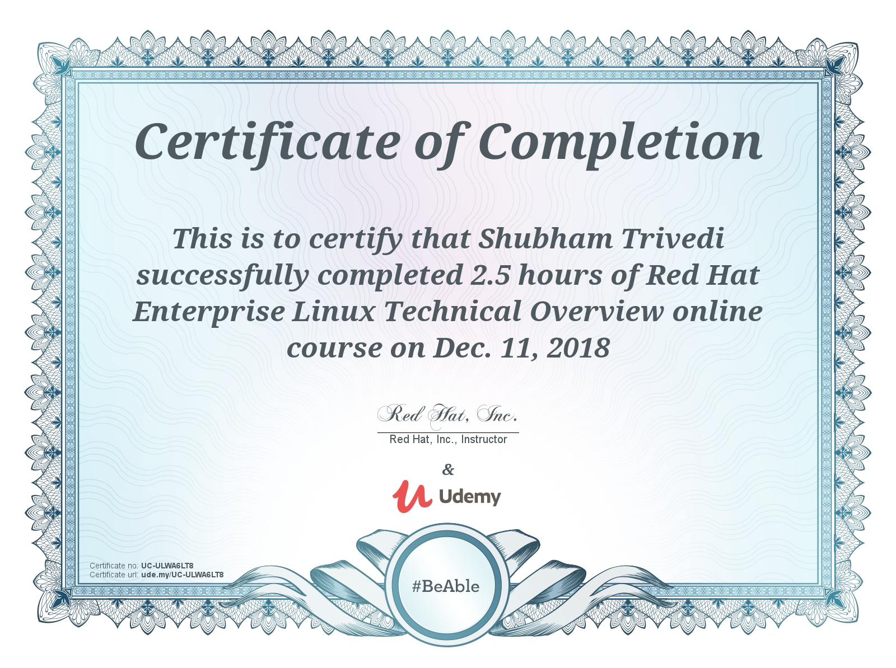

---
{
  "title": "Learning archive: Django and enterprise Linux",
  "summary": "Early Udemy courses in Django and Red Hat Enterprise Linux, including the Django skills that helped our team win SIH 2018.",
  "category": "training",
  "status": "Completed"
}
---

## Django foundations

I completed A Beginners Guide to Django on July 20, 2017.

[Verify the Django certificate on Udemy](https://ude.my/UC-F7HNQIFW)

The knowledge I gained through this course helped our team win the Smart India Hackathon (SIH) 2018. It was an early example of carrying what I learned beyond the course and into a team achievement. [Read the SIH 2018 story](/posts/smart-india-hackathon.html).

## Enterprise Linux foundations

I completed the Red Hat Enterprise Linux Technical Overview course on December 11, 2018.

[Verify the Red Hat course certificate on Udemy](https://ude.my/UC-ULWA6LT8)
