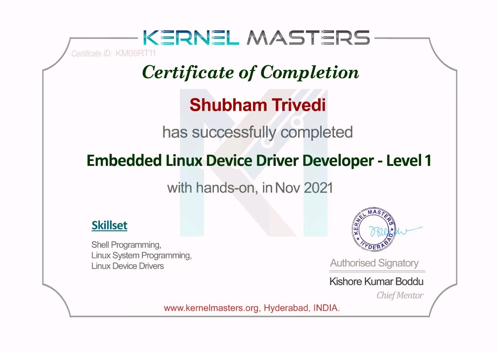
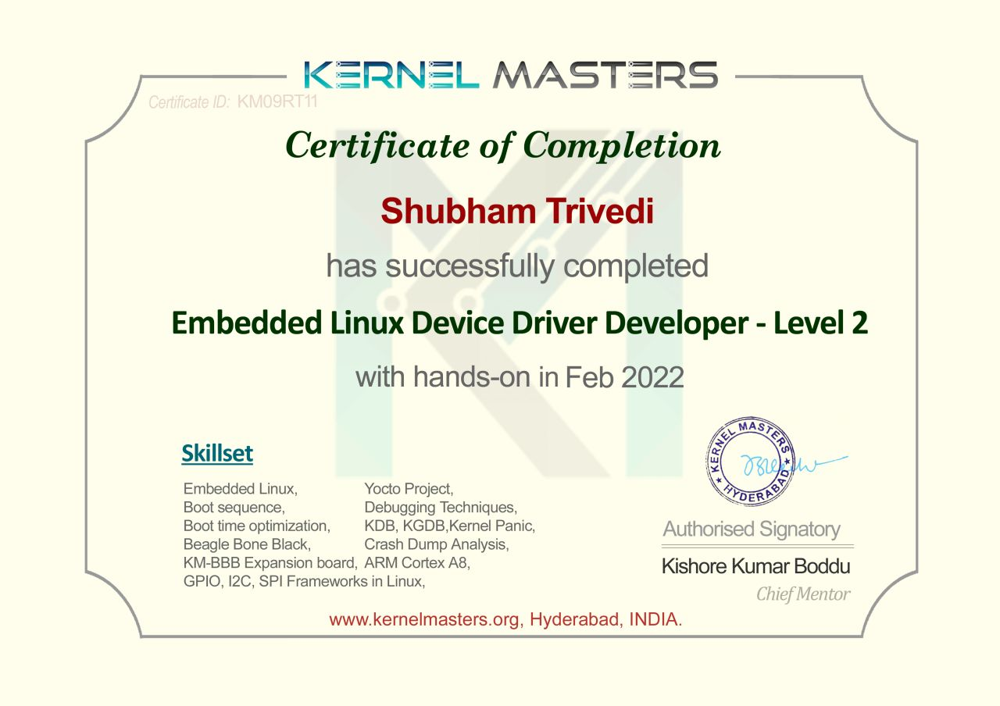

---
{
  "title": "Hands-on Embedded Linux device driver training",
  "summary": "How hands-on Kernel Masters training deepened my understanding of Linux, from system programming to device drivers.",
  "category": "training",
  "status": "Completed",
  "image": "/assets/images/kernel-masters-level-1.jpg",
  "image_alt": "Kernel Masters Embedded Linux Device Driver Developer Level 1 certificate"
}
---

## Building a Linux foundation: Level 1

I completed Kernel Masters' Embedded Linux Device Driver Developer - Level 1 course with hands-on work in November 2021. It helped me gain a deeper understanding of the Linux world, including shell programming, Linux system programming, and Linux device drivers.

The hands-on exercises with a BeagleBone Black and Kernel Masters' custom development board gave me practical exposure alongside the course concepts. Working with real embedded hardware helped me connect Linux programming with the systems it runs on.

## Continuing the journey: Level 2

I completed Level 2 with hands-on work in February 2022. It covered the Linux boot sequence, boot-time optimization, Yocto, debugging, crash analysis, BeagleBone Black, and GPIO, I2C, and SPI frameworks.

Thanks to Inpixon for sponsoring the course.

[Original LinkedIn post](https://www.linkedin.com/feed/update/urn:li:activity:6904374697098661889/)
