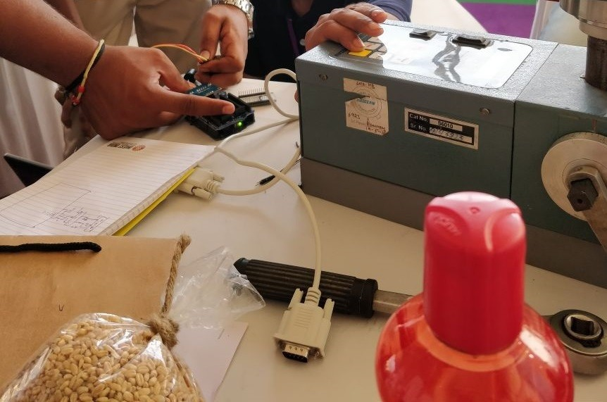
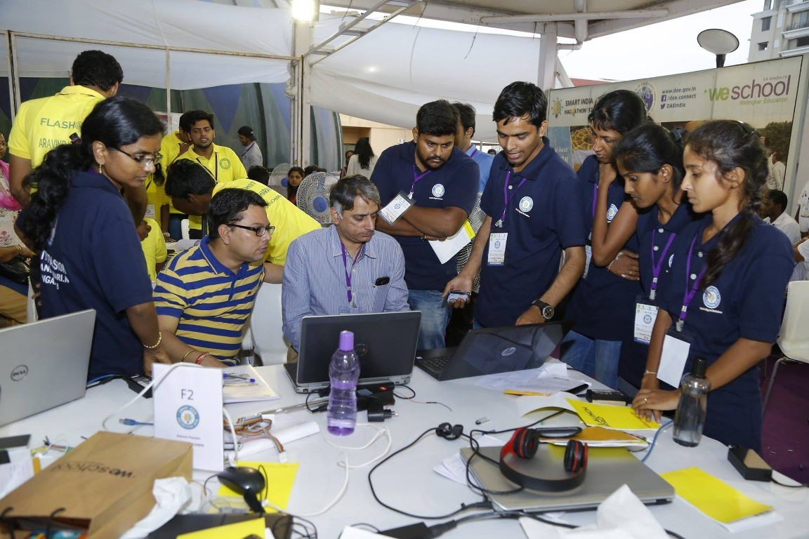
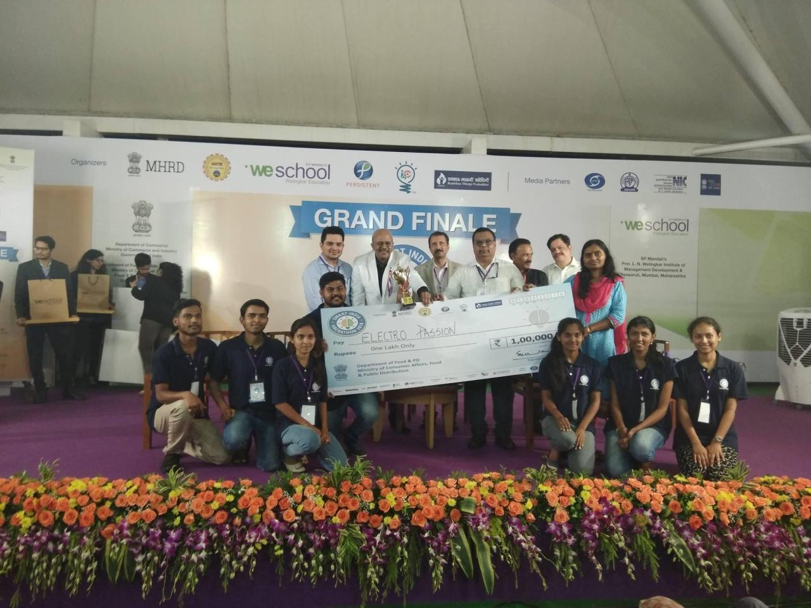
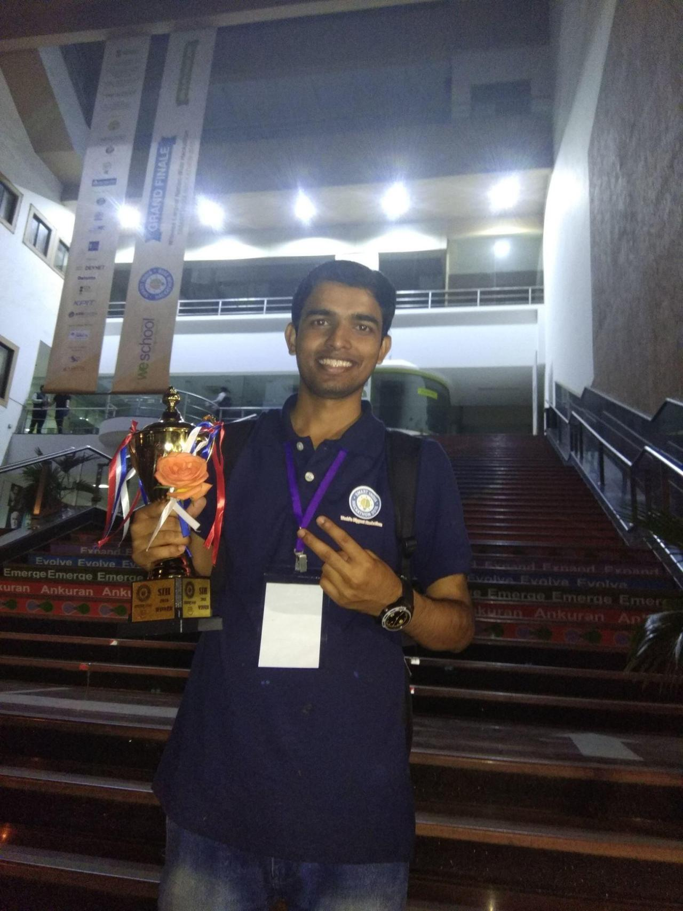

---
{
  "title": "Smart India Hackathon 2018: grain moisture data over WiFi",
  "summary": "Our winning team connected an existing grain moisture meter to a Django server using RS232 and ESP8266 WiFi for a Food Corporation of India project.",
  "category": "community",
  "status": "Award",
  "featured": true,
  "image": "/assets/images/hackathon-team.jpg",
  "image_alt": "The hackathon team photographed at the grand finale with its award"
}
---

## The problem: from paper readings to server records

The project requirement came from the Food Corporation of India (FCI). A grain moisture meter was already available at the client location, but its readings were recorded on paper and later entered into a computer.

The client wanted the readings generated by the meter to be recorded automatically on a server using WiFi and Internet of Things (IoT) technology, removing the need to copy each reading by hand.

## Our solution: RS232, ESP8266, and Django

We used the existing meter's RS232 port to read the grain moisture data. An ESP8266 WiFi module then sent that data to a locally hosted server. On the server side, we used Python Django to receive the readings and store them in a database.

The Django server code is available in the [`moisture_api` GitHub repository](https://github.com/shubhamtrivedi95/moisture_api).

```text
Grain moisture meter
    -> RS232 data
    -> ESP8266 over WiFi
    -> Locally hosted Python Django server
    -> Database
```

This approach kept the client's existing measuring instrument and added a data path from the meter to the database. The server was locally hosted, rather than a public cloud service.



## Applying what I had learned

The knowledge I gained through my Django course helped our team win SIH 2018. This project connected that web-development learning with a physical instrument and a WiFi-enabled data collection workflow.

[See the Django course certificate and verification link](/posts/learning-archive.html).

## Demonstration and team recognition

We presented the project at the Smart India Hackathon 2018 grand finale at Welingkar Institute of Management, where our team won.






The project description above is my first-hand account of our team's solution. The photographs document the prototype work, event demonstration, and award; they do not establish a later production rollout or measured operational impact.

[Original LinkedIn post](https://www.linkedin.com/feed/update/urn:li:activity:6386862751217741824/)

