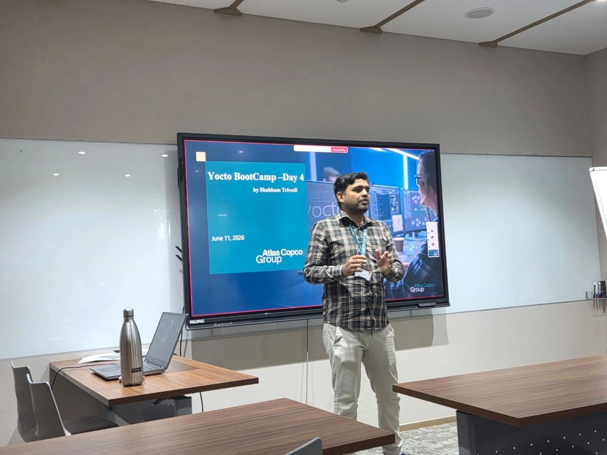
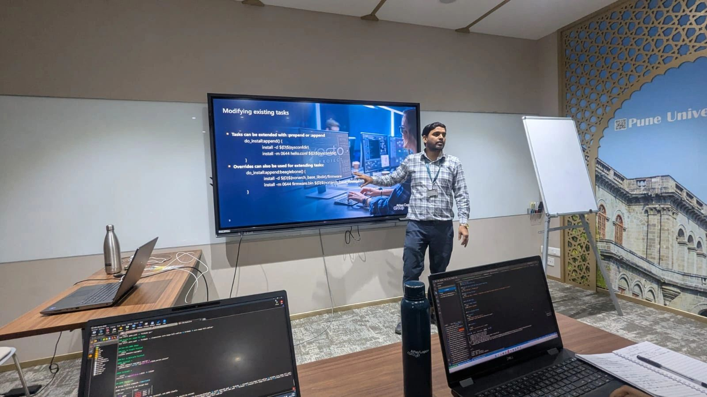
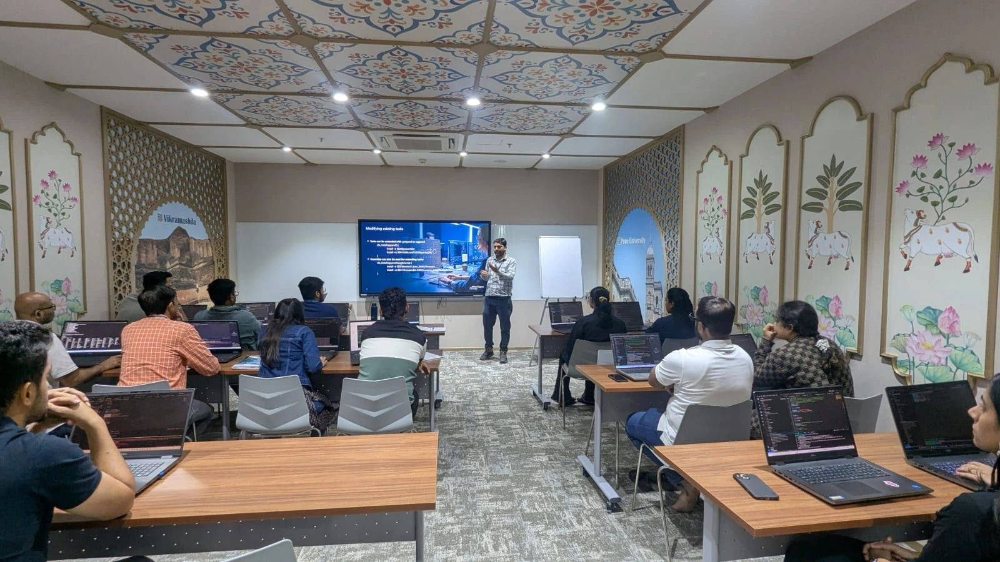
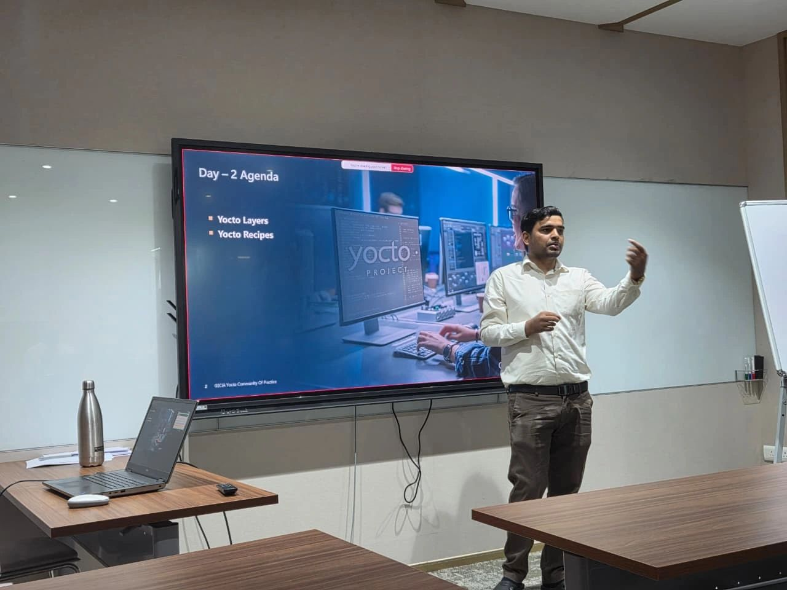
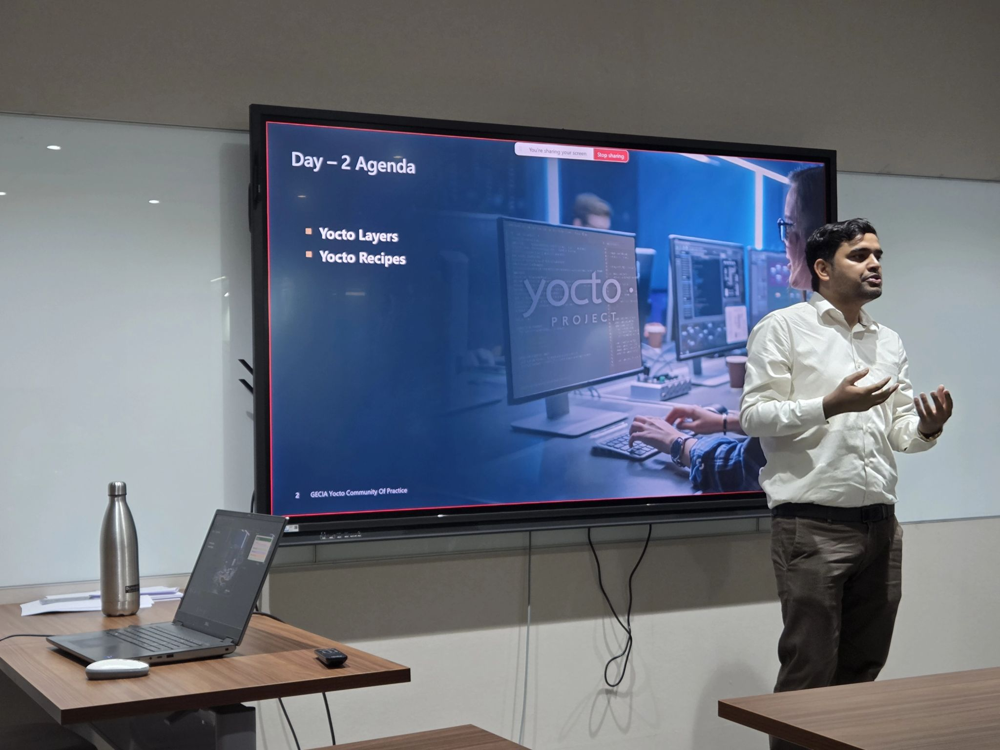

---
{
  "title": "Teaching Yocto: two bootcamps, 35 colleagues",
  "summary": "Hands-on knowledge sharing at Atlas Copco, spanning BitBake metadata, recipes, layers, and custom Linux images.",
  "category": "community",
  "status": "Delivered",
  "date": "2026-06-12",
  "featured": true,
  "image": "/assets/images/bootcamp-day4.jpg",
  "image_alt": "Shubham presenting Day 4 of the Yocto bootcamp"
}
---

## What I contributed

I conducted two Yocto bootcamp batches for colleagues at Atlas Copco: 20 participants on January 6–12, 2026, and 15 on June 8–12, 2026. The aim was practical understanding of building and maintaining custom Embedded Linux distributions.

## Technical scope

- Linux and Yocto foundations, BitBake architecture, and metadata.
- Recipes, append files, and custom layers.
- Image and kernel customization, packages, and root filesystem generation.
- Tools including devtool, recipetool, bitbake-getvar, and bitbake-layers.

The course materials are internal and are not published here.

## From the sessions

Photos originally shared in my LinkedIn post, in a personal capacity.

[Original LinkedIn post](https://www.linkedin.com/feed/update/urn:li:activity:7482102786525028352/)

[Explore my public Yocto board lab](/posts/yocto-board-lab.html)
